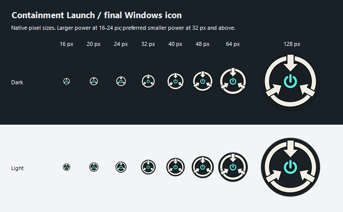

# SCPSL-ModLaunch icon concepts

Icon concept samples generated on 2026-09-29 with the built-in image generation tool. Each PNG preserves its generated transparency. The selected teal-power design is now embedded in the launcher as a multi-resolution Windows icon.

## Final icon

[modlaunch.ico](../../../src/SCPSL.ModLaunch/Assets/modlaunch.ico) contains ten sizes: 16, 20, 24, 32, 40, 48, 64, 96, 128, and 256 pixels. The larger power symbol is used at 16, 20, and 24 pixels because the smaller symbol loses definition there. The preferred smaller symbol is retained at 32 pixels and above.

The previews were visually reviewed at native size and with enlarged pixels. All ten frames decoded through the Windows icon API with the expected dimensions and transparent corners. A Release build passed with no warnings or errors; its primary executable icon contains all ten PNG frames byte-for-byte identical to the ICO.

Regenerate the ICO on Windows with `scripts/build-launcher-icon.ps1`. The [.ico asset notes](../../../src/SCPSL.ModLaunch/Assets/README.md) describe the source images and export.

## Containment Launch variations

The selected containment seal now has three alternate center treatments. See [CONTAINMENT-REVISIONS.md](CONTAINMENT-REVISIONS.md) for the samples and exact edit prompts.

| Teal play | Teal power | Ivory launch arrow |
| --- | --- | --- |
|  |  |  |

**Selected: teal power.** The center suggests switching on facility equipment, with extra space separating it from the three containment arrows.

## First concepts

| Containment Launch | Access Granted | Breach Door |
| --- | --- | --- |
|  |  |  |
| Ivory containment arrows and an orange launch triangle. | A yellow facility keycard with a launch control. | A powered industrial doorway with a teal launch triangle. |

**Initial selection: Containment Launch.** Its containment geometry gives it a strong SCP connection. Access Granted emphasizes entering the facility; Breach Door emphasizes the game's industrial setting.

The keycard and doorway directions draw on the game's [keycard access system](https://en.scpslgame.com/index.php/Keycard). These are original concept illustrations rather than extracted game assets.

The launcher embeds `Assets/modlaunch.ico` through `ApplicationIcon` in `src/SCPSL.ModLaunch/SCPSL.ModLaunch.csproj`. Its existing shortcut code selects icon index 0 from the launcher executable.

See [PROMPTS.md](PROMPTS.md) for the exact generation prompts.
